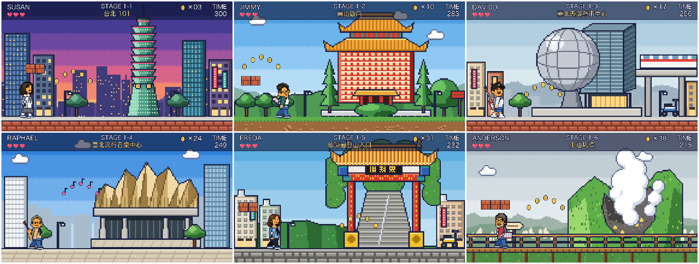

# Real-8bit

台北六景 8-bit 橫向捲軸關卡畫面。



| 關卡 | 地標 | 角色 |
| --- | --- | --- |
| 1-1 | 台北 101 | Susan |
| 1-2 | 圓山飯店 | Jimmy |
| 1-3 | 臺北表演藝術中心 | Davidd |
| 1-4 | 臺北流行音樂中心 | Raphael |
| 1-5 | 仙跡岩登山入口 | Freda |
| 1-6 | 小油坑橋 | Anderson |

## 目錄

- `stages/`：六張 1920×1080 關卡畫面與總覽
- `landmarks/`：六個地標的透明底像素圖（576×576）與總表
- `heads/`：從海報擷取的六人頭部像素圖
- `characters/<名字>/`：8-bit 角色（帶樂器）：`right_walk1~3`、`right_jump`、`left_*`（鏡像）、`front_play1~2`（正面演奏）；`anchors.json` 記錄腳底中心，`_preview.png` 是總表

## 重新產生

需要 Python 3 與 Pillow、numpy、opencv-python-headless（擷取頭部用）。

```bash
pip install pillow numpy opencv-python-headless
python landmarks.py landmarks
python extract_heads.py reference/band_poster.webp heads
python sprites.py characters
python scenes.py stages characters
```

角色的頭取自樂團海報 `reference/band_poster.webp`（`extract_heads.py`：GrabCut 去背、每人 10 色、每格取最多的色群），
身體、手腳與樂器由 `sprites.py` 依海報服裝配色畫出（約 30×58 像素，場景中 1:1 貼在 2 倍場景層）。
樂器：Susan、Freda 麥克風（主唱），Jimmy keytar，Davidd 電 bass，Raphael 木吉他，Anderson 行進小鼓。
